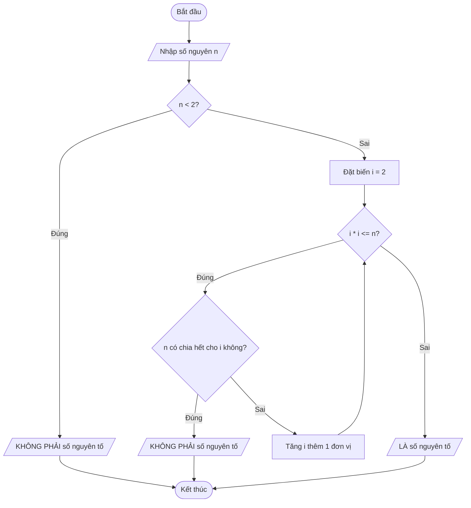

# bai-thuc-hanh-01
# BÀI TẬP CHƯƠNG 1

## Bài 1: Giải phương trình ax² + bx + c = 0
```mermaid
graph TD
    Start([Bat dau]) --> Nhap[/Nhap a, b, c/]
    Nhap --> KiemTraA{a == 0?}
    
    %% Neu a = 0,  pt bac 1: bx + c = 0
    KiemTraA -- True --> KiemTraB{b == 0?}
    KiemTraB -- True --> KiemTraC{c == 0?}
    KiemTraC -- True --> VSN[/Pt vo so nghiem/]
    KiemTraC -- False --> VN1[/Pt vo nghiem/]
    KiemTraB -- False --> PtBac1[ x = -c / b] --> InX1[/In nghiem x/]
    
    %% Nếu a != 0
    KiemTraA -- False --> TinhDelta[ Delta = $\sqrt{b}$ - 4ac]
    TinhDelta --> KiemTraDelta{Delta < 0?}
    KiemTraDelta -- True --> VN2[/Pt vo nghiem/]
    KiemTraDelta -- False --> DeltaBang0{Delta == 0?}
    
    DeltaBang0 -- True --> TinhNghiemKep[ Tinh nghiem kep :x = -b / 2a] --> InKep[/In nghiem kep x/]
    DeltaBang0 -- False --> Tinh2Nghiem[Tinh x1 và x2 ] --> In2Nghiem[/In 2 nghiem x1, x2/]
    
    VSN --> End([Ket thuc])
    VN1 --> End
    InX1 --> End
    VN2 --> End
    InKep --> End
    In2Nghiem --> End
```
## Bài 2: Kiểm tra Số Nguyên Tố

## Bài 3: Tìm số lớn nhất trong dãy số

## Bài 4: Tìm Bội số chung nhỏ nhất (BCNN)

