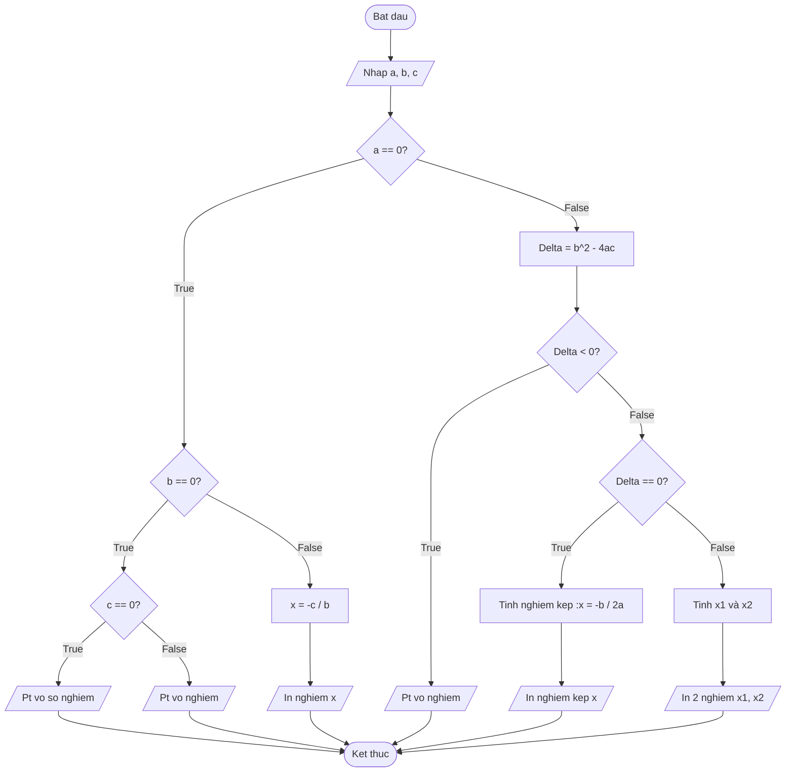
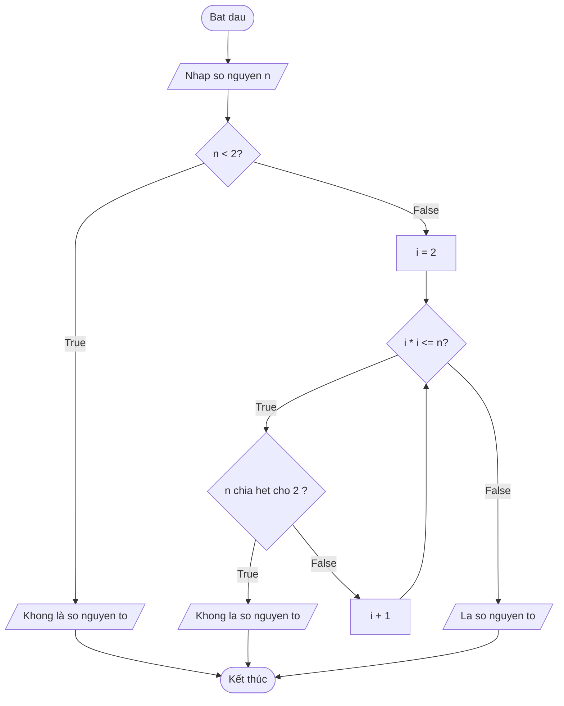
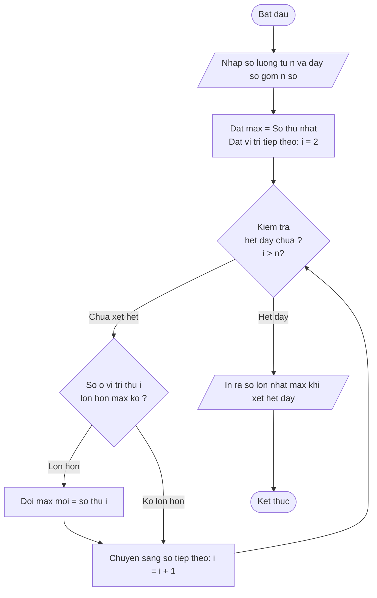
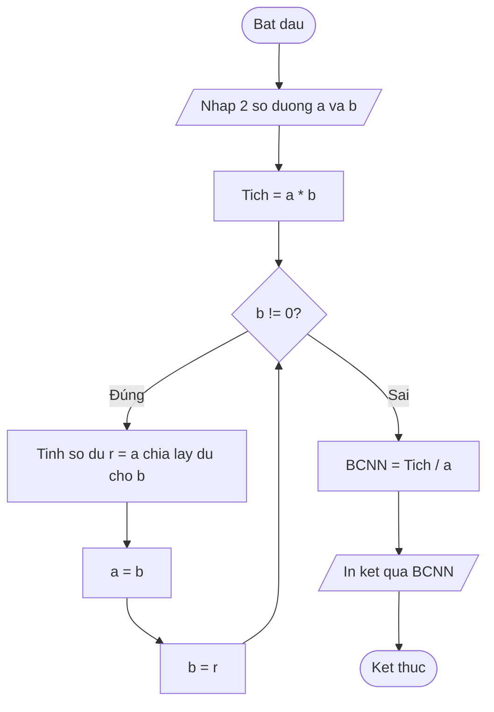

# bai-thuc-hanh-01
# Bai tap chuong 1

## Bai 1: Giai phuong trinh ax^2 + bx + c = 0

#include <stdio.h>
#include <math.h>
void Giaiphuongtrinhbac2(float a,float b, float c)
{
	printf("Giai phuong trinh: %.2fx^2 + %.2fx + %.2f = 0\n",a,b,c);
	if(a==0){
		if(b==0){
			if(c==0){
				printf("Phuong trinh co vo so nghiem\n");
			}
			else{
				printf("Phuong trinh vo nghiem\n");
			}
		}else {
			float x = -c/b;
			printf("Phuong trinh co nghiem duy nhat %.2f\n",x);
		}
	}
	else {
		float delta = b*b - 4*a*c;
		printf("%2.f\n",delta);
		if(delta<0){
			printf("Phuong trinh vo nghiem\n");
		}else{
			float x1= (-b-sqrt(delta) / 2*a);
			float x2= (-b+sqrt(delta) / 2*a);
			printf("Phuong trinh co hai nghiem phan biet\n");
			printf("x1= %.2f\n",x1);
			printf("x2= %.2f\n",x2);	
		}
	}	
}
int main()
{
	float a,b,c;
	printf("Nhap he so a,b,c:");
	scanf("%f %f %f",&a,&b,&c);
	Giaiphuongtrinhbac2(a,b,c);
	return 0;
}
## Bai 2: Ktra so nguyen to

## Bai 3: Tim so lon nhat trong day so

## Bai 4: Tim boi chung nho nhat (BCNN)

