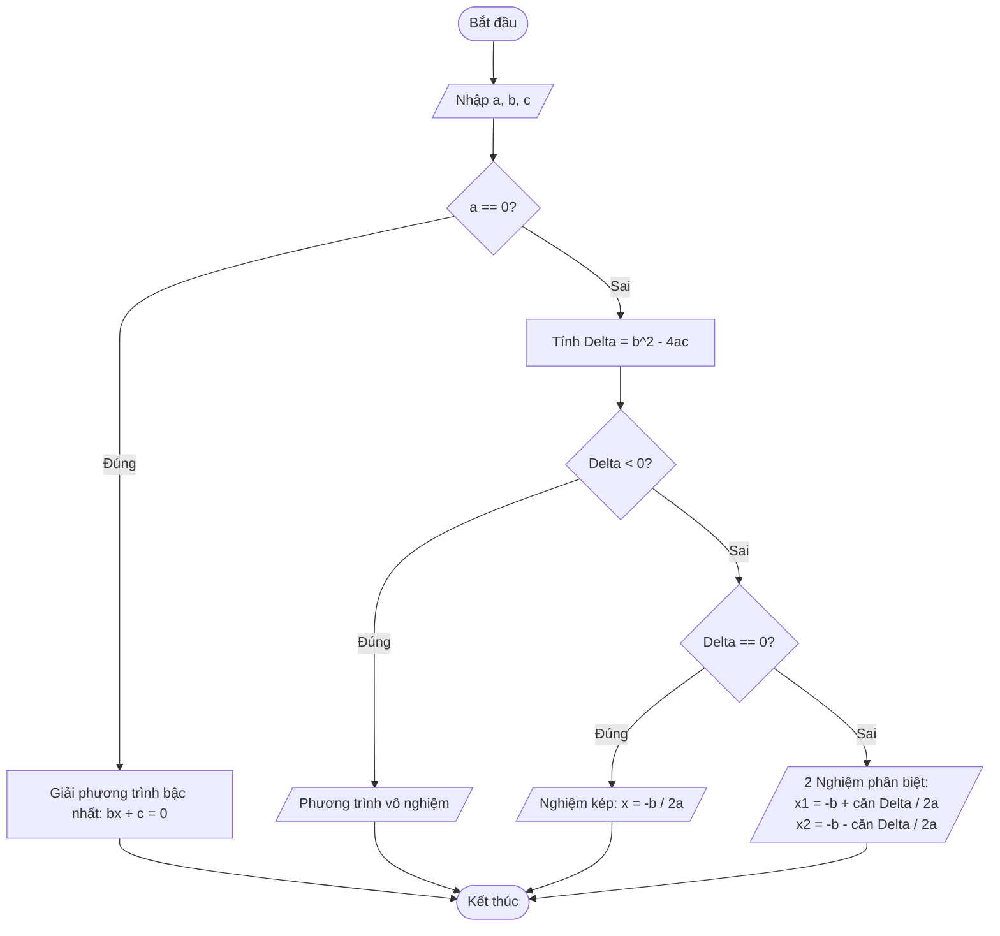

# bai-thuc-hanh-01
## bai 1: So do khoi giai phuong trinh ax^2+bx+c=0

## bai 2: Kiem tra so nguyen duong n co phai so nguyen to khong
```mermaid
graph TD
   A([Begin]) --> B[/Nhap so nguyen duong n/]
   B-->C["count = 0<br>i=2"]
%% Vong lap chinh
   C-->D{i<=$\sqrt{n}$}
%% Neu i<=$\sqrt{n}$ dung (True)
   D--True-->E{n % i == 0}
%% Neu n % i == 0 dung(True)
   E--True-->F[count++]
   F-->G[i++]
%% Neu n % i == 0 sai(False)
   E--False-->G
   G-->D
%% Neu i<=$\sqrt{n}$ sai(False)
   D--False-->H{count == 0}
%% Neu count == 0 dung(True)
   H--True-->I[/n la so nguyen so/]
%% Neu count == 0 sai (False)
   H--False-->J[/n ko laf so nguyen to/]
   I-->K([End])
   J-->K
```

