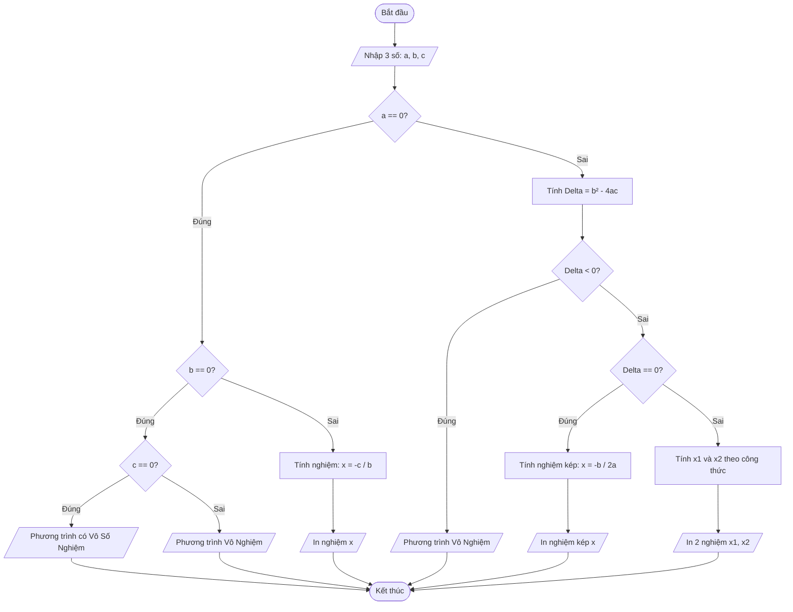
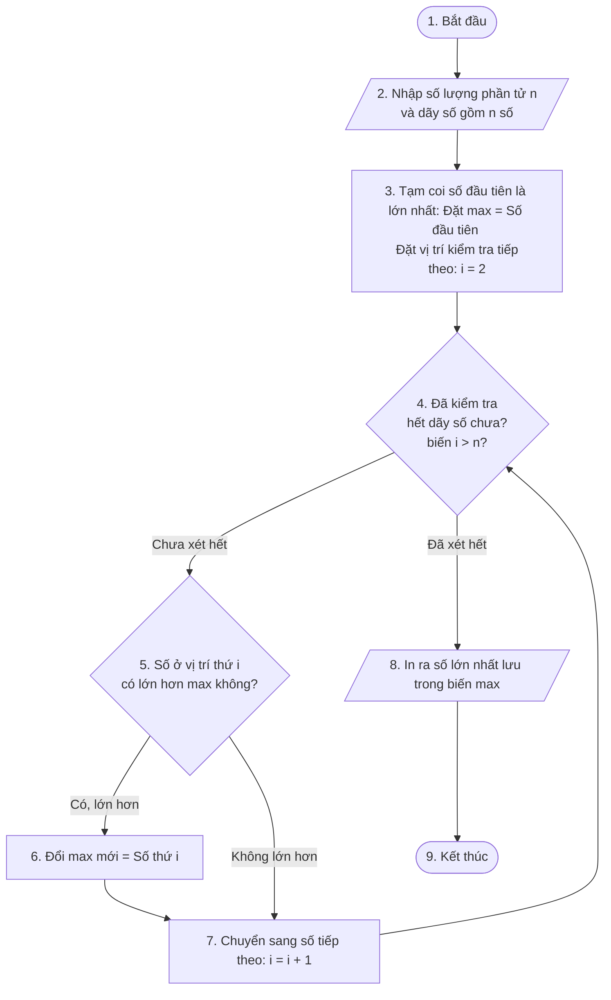
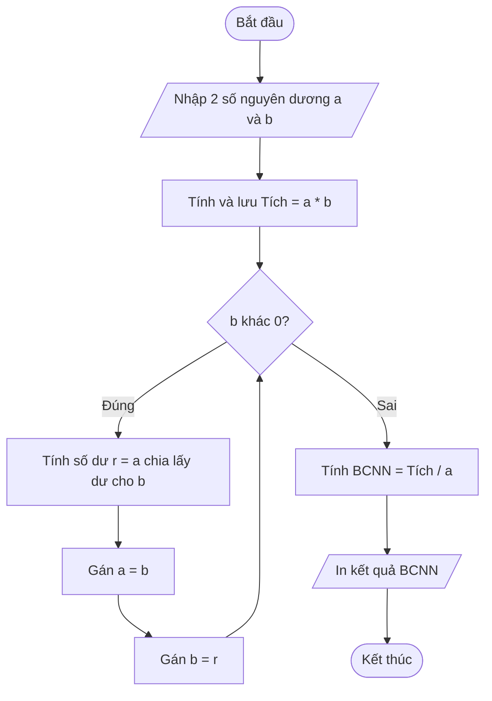

# bai-thuc-hanh-01
# BÀI TẬP CHƯƠNG 1

## Bài 1: Giải phương trình ax² + bx + c = 0

## Bài 2: Kiểm tra Số Nguyên Tố

## Bài 3: Tìm số lớn nhất trong dãy số

## Bài 4: Tìm Bội số chung nhỏ nhất (BCNN)

